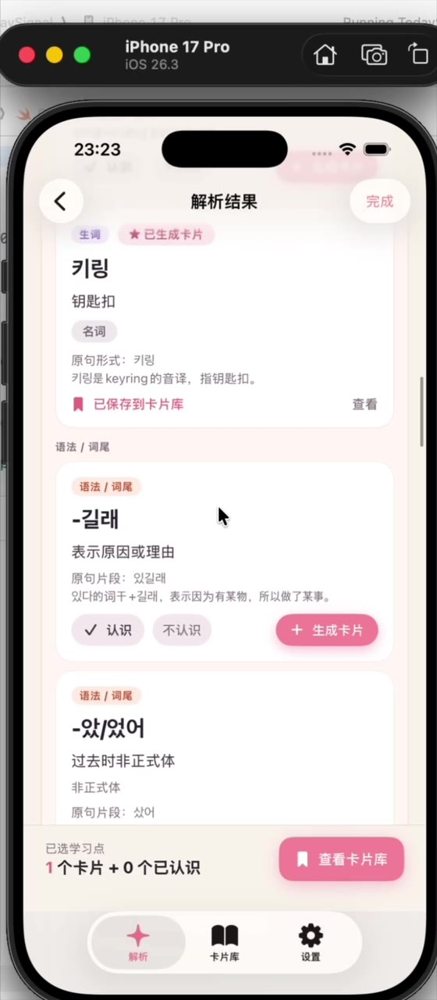

# Today's Signal · 오늘의 시그널

**主要面向偶像 Weverse DM 场景的韩语学习 iOS App。** 除了逐句理解消息内容，还能学习聊天语气、语法和生词，并把有用的表达存成学习卡片。用户可以上传截图或粘贴文字，在解析前确认识别出的聊天气泡。

[English](README.md) · [简体中文](README.zh-CN.md)

> **项目状态：** 独立开发的 MVP，尚未上架 App Store。App 内界面是中文；英文文档用于向不懂中文的读者介绍项目。目前 Xcode 工程的最低系统版本为 iOS 26.2。

## 演示视频

[](media/todaysignal-demo.mp4)

[观看 48 秒演示视频（MP4）](media/todaysignal-demo.mp4)。视频展示了引导页、OCR 文字确认、逐条解析和卡片库，录制环境为 iPhone 模拟器。

## 主要功能

- **截图转聊天文本：** 使用 Apple Vision 在设备上识别韩语，尝试按气泡分组，并允许用户在解析前编辑文字。
- **结合语境学习：** 按消息展示中文翻译、语气、生词和语法／词尾说明。
- **积累学习卡片：** 用 SwiftData 在本机保存生词和语法卡片，并标记已认识或暂不学习的知识点。
- **练习韩语回复：** 生成回复建议、检查自己的回复，也可以针对解析结果继续提问。

## 技术实现

界面使用 SwiftUI；`OCRService` 负责本机文字识别。AI 服务通过协议区分 mock 模式和可选的 OpenAI 实时模式，返回结构化结果后再解码校验，失败时提供可见的重试入口。卡片和知识点标记保存在 SwiftData。

```text
截图或粘贴文本 → OCR／可编辑聊天气泡 → 解析与回复功能
                                 ↓
                         本机学习卡片（SwiftData）
```

## 本地运行

1. 用 Xcode 打开 `TodaySignal.xcodeproj`，选择 `TodaySignal` scheme，在 iOS 26.2 或更新版本的模拟器／设备上运行。真机运行时，在 Signing & Capabilities 中选择自己的开发团队。
2. 默认使用 mock AI 数据，不需要 API Key，即可体验主要交互流程。
3. 若只用于个人开发测试，可在 **Product → Scheme → Edit Scheme → Run → Arguments → Environment Variables** 添加 `USE_REAL_OPENAI=1` 和 `OPENAI_API_KEY=<你的密钥>`。可选的 `OPENAI_MODEL` 默认是 `gpt-4.1-mini`。不要把密钥提交到仓库。

启用实时 AI 后，确认过的聊天文本和相关追问上下文会从 App 发送给 OpenAI。截图的 OCR 在设备上运行，App 不保存原始截图。目前 API 请求直接从客户端发起；如果以后公开发布，需要改为由服务端保管密钥并转发请求。

## 当前边界与后续计划

这是已能运行的个人 MVP，还不是经过发布验证的产品。仓库里有 Swift Testing 的服务与状态流程测试；发布前仍需完整的模拟器流程 QA、CI、无障碍检查和性能测量。首页“最近”目前展示静态示例，并不是真实解析历史；本地存储失败也还没有向用户提示。我会优先处理这些问题。

更详细的产品设计与开发记录见 [PRD](TodaySignal/Docs/PRD.md) 和 [V1 开发记录](TodaySignal/Docs/development-progress-v1.md)。
